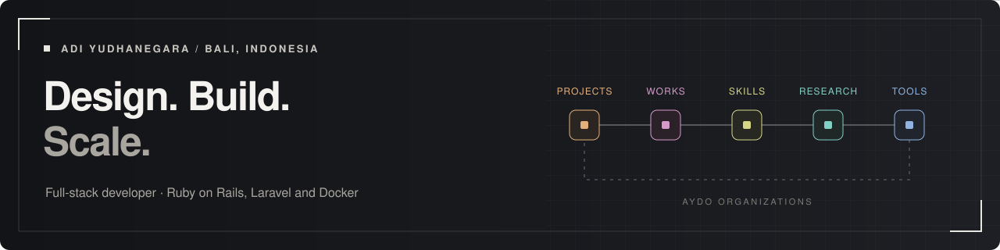

# Hi, I'm Adi Yudhanegara

**Full-stack developer in Bali, Indonesia, building web applications from the database to the deployment.**

I hold a degree in Information Systems and work across the stack: backend architecture in Ruby on Rails with Hotwire and Laravel, admin panels with Filament, content sites on Winter CMS, web interfaces in JavaScript and TypeScript, and mobile clients in Flutter. I also handle graphic design in Photoshop and CorelDRAW. Every project runs in a reproducible Docker environment, and much of my day-to-day work happens alongside AI coding agents such as Claude Code and Codex.

## Organizations

My work is split into five organizations, each with its own purpose.

| Organization | What lives there |
| :--- | :--- |
| **[AYDO Projects](https://github.com/AYDO-Projects)** | My own web applications and sites, one repository per project. |
| **[AYDO Works](https://github.com/AYDO-Works)** | Freelance and client projects, kept separate so ownership stays clear. |
| **[AYDO Skills](https://github.com/AYDO-Skills)** | Skills and workflows for building software with Claude Code and Codex. |
| **[AYDO Research](https://github.com/AYDO-Research)** | Structured technical learning, from first discussion to presentable material. |
| **[AYDO Tools](https://github.com/AYDO-Tools)** | Docker development environments for Laravel, Winter CMS and native PHP. |

## How I work

- **Reproducible environments.** Any project can be set up again from its repository and a shared Docker template.
- **One project, one repository.** Each project keeps a clear history and a clear owner.
- **Verifiable results.** Every change comes with a record of what was done and how it was checked.
- **People decide.** AI agents speed up the work; goals and key decisions stay with people.

## Tech Stack

## Reach me at

>     

---

Most of my work lives in private repositories. The organizations above describe how it is organized.
